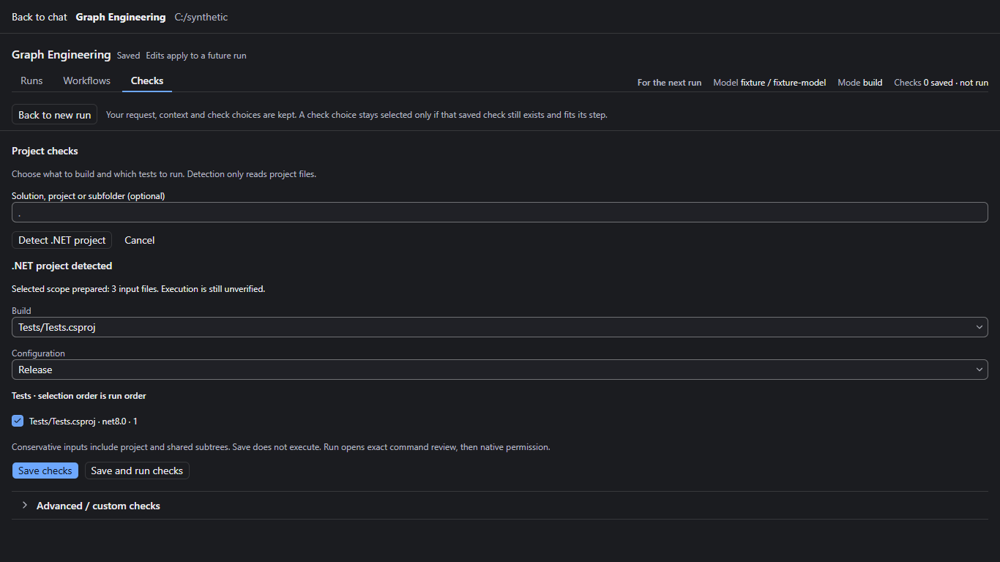
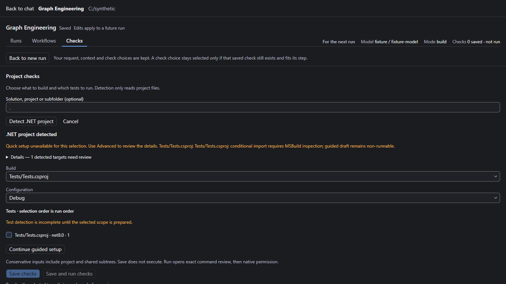
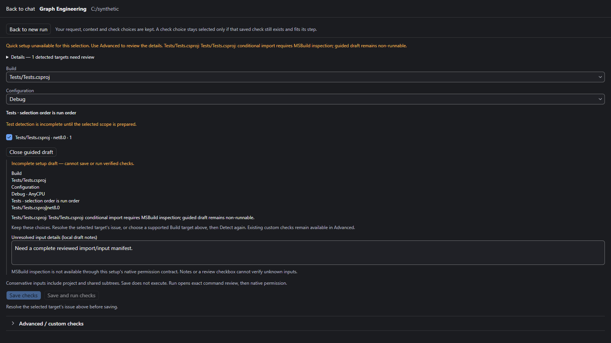
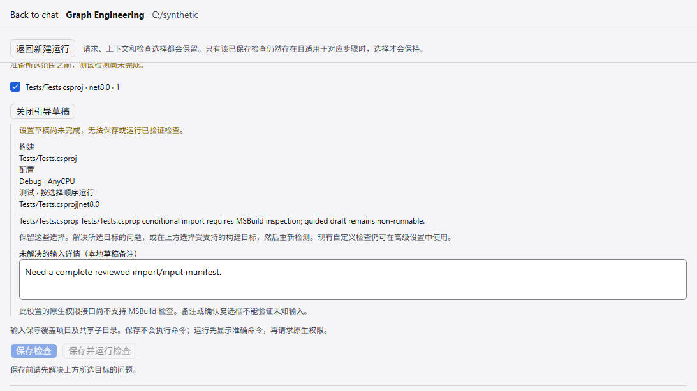

# Z8.5-U4 implementation and review handoff

This is source development against integration
`452a24082f08fbcff2e2617602d464ccd158f113`. The installed `.307` pilot, all
installers, tags, releases and retained candidates were left unchanged. Only
disposable synthetic projects and cached public packages were used.

## Implemented support

| Pattern               | Actual boundary                                                                                                                                                                  |
| --------------------- | -------------------------------------------------------------------------------------------------------------------------------------------------------------------------------- |
| SDK/output            | Literal `Microsoft.NET.Sdk`, established `bin/Configuration/Framework/Assembly.dll` layout; Debug/Release and default AnyCPU                                                     |
| File items            | Compile, Content, None, EmbeddedResource; finite semicolon lists and bounded `*`, `?`, full-segment `**`                                                                         |
| Operations            | Ordered Include with local Exclude, existing-item-only Update, Remove; zero-match glob accepted; duplicate effective Includes rejected                                           |
| Metadata              | Literal CopyToOutputDirectory/CopyToPublishDirectory values Never, Always, PreserveNewest, IfDifferent; contained Link/TargetPath/DependentUpon and simple LogicalName           |
| Shared files          | `..` may leave the project directory while staying inside the workspace; imported item paths remain relative to the main project                                                 |
| Properties/conditions | Explicit literal property subset; simple single equality/inequality on Configuration, Platform or an established TargetFramework; no general expression evaluator                |
| Imports               | Bounded literal imports, direct MSBuildThisFileDirectory expressions, nearest Directory.Build.props/targets and Directory.Packages.props; property pass precedes item evaluation |
| Defaults/order        | SDK default Compile/EmbeddedResource/None rules within the stated subset; file items in pre-default props are rejected because their ordering is not modeled                     |
| Freshness             | Copied non-code bytes, shared roots, imports and future glob members reach existing save/reload, preview, fingerprint and evidence owners                                        |

Conservative coverage includes regular files throughout the selected project and
shared input subtrees, including files excluded/removed from individual items.
The UI discloses this extra coverage. There is no first-N truncation or timestamp
cache. Existing U3 count, byte, depth, cancellation and identity checks remain;
item expansion adds a 2,048-operation / 1,000,000 pattern-file budget and imports
are bounded to 64 documents / depth 16.

Unsupported shapes remain actionable, non-runnable drafts: conditional imports;
arbitrary conditions/property functions/unknown properties; custom SDKs, targets,
tasks, output paths and generators; escaped item syntax and transforms; external
paths/reparse aliases; typed, indirect, serialized, schema-bearing or custom-reader
resx inputs (only plain string resx is accepted); repeated/cyclic imports;
unknown metadata; file items before SDK defaults; unresolved multi-framework
conditions. Explicit declarations intersecting excluded state/output trees require
a provable subtree Exclude or a narrower pattern. This is not universal MSBuild
equivalence. Package/toolchain readiness remains an execution-time requirement,
and a filename containing Test does not establish a runner.

## UI and compatibility

Quick distinguishes not-started, preparing, ready, failed, cancelled and unsupported.
The selected target's actual failure precedes generic preparation guidance;
unrelated diagnostics stay in Details. Unresolved selections remain visibly marked.
Configuration agrees with commands, output paths, dependency scope and saved review.
Save requires a matching prepared scope and presents a current disabled reason.

Guided continuation retains target/configuration/test choices and notes in the
existing workspace draft store. It shows unresolved facts without accepting a
checkbox as verification. Existing custom recipes are not overwritten; Advanced
can edit both scope versions without losing filters, timeouts, required tests or
outputs. The continuation does not resolve arbitrary project code: its draft must
be re-prepared through the existing host before executable checks can be saved.

New configurations carry explicit `sourceScope.version = 2` with Configuration.
Version 1 uses the original parser and membership/digest reconstruction. Historical
receipts are neither rehashed nor rewritten. Older readers, including `.307`, do
not understand v2; retain a compatible configuration/profile for downgrade.

**MSBuild inspection subpath is blocked.** The existing setup facade exposes
passive environment/capture operations but has no bounded, permission-owned
inspection result/capability/freshness contract. No second launcher, fake success
action, automatic restore or silent inspection was introduced. Inspection denial,
cancellation and stale-receipt tests are therefore not claimed. The executable
MSBuild calls in the oracle are explicit synthetic test actions only.

## Validation and evidence

- Focused parser/Quick tests: 11 passed, including the 5,003-input save/reload and
  freshness case. Its isolated prepare was 3,295 ms and fingerprint 10,106 ms.
- U3 100-project / 5,101-input regression passed. The unchanged boundary suite
  covers exact source-count, source-byte, aliases, malformed XML and incomplete
  closure behavior. No limits or exclusions were weakened.
- Unchanged F2 RunInfo evidence regressions: 2 passed. The portable genuine-fixture
  tests requiring a separate owned receipt retain their two normal skips.
- Additional v2/manual-form round-trip tests: 8 passed; content/shared/import
  freshness checks passed after the final test additions.
- Full portable selector on Windows: 993 tests, 989 passed, 2 failed, 2 skipped.
  Failures are the unchanged Windows ASAR-header hash assertion and absolute-path
  ESM config import. The Linux suite also expects four skips, while Windows runs
  its two platform-specific tests. These results are not represented as green.
  A prior concurrent run also hit a transient ENOTEMPTY cleanup failure; the final
  services group passed 592 with two skips. Initial sandbox-only attempts failed
  on filesystem/process restrictions and are not acceptance evidence.
- Typecheck passed. Pre-push lint: 75 existing warnings, zero errors; architecture:
  zero violations. All new portable tests sit in existing CI-selected directories;
  no CI gate, selector or exclusion was changed.
- Browser suite: 3 passed. Real components and setup services over synthetic
  files, with labeled transport/native-environment fixtures; zero run or preview
  creation during Detect/Save. It covers Release Save/reopen, conditional import
  failure, retained guided notes after cancellation and a Chinese view.
- Installed oracle: .NET SDK 8.0.425, MSBuild 17.11.48.46605. Debug/Release output
  identity, copied Content/None and embedded-resource metadata agree with the
  installed engine. Only net8.0 has native Build/Test proof; parsing other literal
  framework names does not establish local toolchain/adapter readiness. Ordered lists, question wildcards, local Exclude, existing-only
  Update, Remove and empty matches also agree. See [oracle receipt](evidence/u4/oracle.json).

Local Node was 24.11.1 rather than the repository's 24.14.0 pin; pnpm was the
locked 10.33.2. No dependency/SDK upgrade or retargeting was performed.

## Native proof status

The source Electron harness uses the existing native permission and evidence
owners with 5,013 source inputs (5,000 generated C# files plus content, shared source
and imports). Detect → Save → reopen passed with zero runs/model requests; saved
configuration and request/context were retained. This is source-native evidence,
not packaged or `.307` evidence.

The first native execution failed NETSDK1064 because the retained synthetic
package cache lacked complete analyzer metadata. The disposable fixture now
rebases already-restored artifacts onto complete copies of existing cached public
packages; no restore/feed request is performed. The next run's approved Build
passed (4,358 ms native command), and Build acceptance was true, but the Test
successor did not reach its permission boundary before the existing harness
deadline. That attempt does not establish Test success.

The separate retry **passed the complete 5,013-input sequence** through the real
UI/native permission owners:

| Case              | Native result and evidence                                                                                                                                |
| ----------------- | --------------------------------------------------------------------------------------------------------------------------------------------------------- |
| Pass              | Build exit 0, Test exit 0; 3/3 real tests passed; accepted original-byte TRX and operation-bound normalization receipt                                    |
| Assertion failure | Same configuration, changed assertion, fresh Build exit 0 and Test exit 1; 2 passed / 1 failed; valid FAIL observation, not parser/infrastructure failure |
| Recovery          | Restore assertion; fresh approved Build/Test exit 0; 3/3 passing evidence accepted                                                                        |
| Stale Content     | Modify copied content after review; confirmation rejected, zero new runs/models                                                                           |

The tests consume copied literal Content, copied None Update, an embedded resource
and a linked shared source. No F2 parser, normalization, permission, admission or
evidence-acceptance rule changed. See the sanitized [native receipt](evidence/u4/native.json).

Native command durations were Build 4,408 / 5,100 / 5,652 ms and Test 1,665 / 1,446 /
1,193 ms. End-to-end overhead is still substantial: admission-to-Build-start was
65,029–73,226 ms, and Build-exit-to-Test-start was 117,280–141,190 ms. These intervals
include repeated required source verification, harness UI work and native permission
interaction, not just command execution. No product deadline was increased and no
freshness boundary was skipped. Independent native reviews then passed all four
stale-input rejection probes: Content bytes, shared source bytes, imported metadata
bytes and a new file matching SDK default-item membership. Each rejected confirmation
created zero new runs/models at 5,013 inputs. See the [freshness receipt](evidence/u4/freshness.json).
An initial helper attempt stopped after the content case because two Close buttons
matched its selector; the corrected helper passed all four cases.

## Review delivery

One [draft PR #22](https://github.com/dumpfordummy/ZCode/pull/22) targets integration;
auto-merge is off. The initial head passed Linux typecheck and graph-tests; static
checks correctly rejected formatting in the spec-first commit. The spec is formatted
and the final-head check state and full head/base/tested-merge SHAs are recorded in
the PR description and final handoff. Earlier green jobs do not certify a later head.

## Small rendered gallery

[Open gallery](evidence/u4/gallery/index.html) · [browser receipt](evidence/u4/browser.json)

The legacy Content screenshot uses the retained v1 policy through current
components; it is not an invented company screenshot or a historical installer
capture. All visible names are synthetic. Native screenshots/raw machine logs are
retained locally and excluded from public upload.

