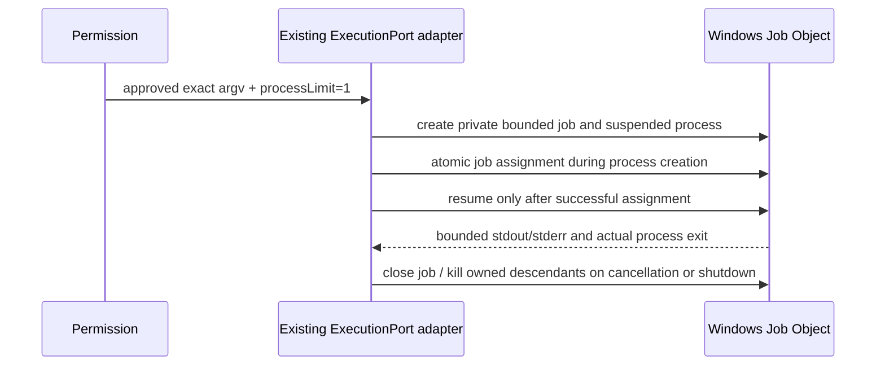

# Z8.5-U5-F1 — owned project configuration inspection

Status: design written before implementation. Acceptance is pending; this document
does not claim implemented inspection, Web support, or large-scope native readiness.

## Recovery and preserved baseline

Continue `codex/z8-5-u5-realworld-dotnet-projects`, draft PR #23. Fresh public PR and
Git reads on 2026-10-14 confirm source `bb31af01746f5e73de05b5134b9eab19fbb14d2d`
and integration `f7279c79824e518abc6f4fdeb2c6cf66b86bac31`; PR remains open/draft.
Retained checkout is clean. Preserve U5 files, fixtures, receipts and failed logs.
U5's 53-input PASS/assertion FAIL/recovery is separate from its two 5,013-input
observer expiries and one disconnected attempt. Those outcomes are not parser failures.

## Authority map and extension design

| Owner                                                                                   | Existing contract                                                        | F1 responsibility                                                                                                              |
| --------------------------------------------------------------------------------------- | ------------------------------------------------------------------------ | ------------------------------------------------------------------------------------------------------------------------------ |
| `project-setup-types.ts`, `app/project-setup.ts`, `app/workflow-service.ts`             | Passive setup facade                                                     | Typed review/start/status/cancel inspection commands; passive scan/save/navigation never execute                               |
| `app/service.ts`, `app/state.ts`, `app/input-guard.ts`                                  | GraphState serial transactions, repository lease, exact one-use dispatch | Own immutable inspection intent and workspace reservation separately from Graph runs; reject conflicting active/uncertain work |
| `app/runtime-ports.ts`, `adapters/runtime-gate.ts`, `domain/native-runtime-contract.ts` | Runtime capability admission                                             | Add optional inspection capability requirement without weakening ordinary Graph requirements                                   |
| `adapters/tools.ts`, native agent service                                               | Runtime-bound create/start/inspect/cancel                                | Carry separate inspection purpose through the existing native process owner; no setup-to-startRecipe bypass                    |
| shared protocol, native `native-recipe-operations.ts`                                   | Strict request identity, one operation, session ownership                | Validate purpose and fixed inspection profile, retain exact invocation identity and bounded terminal facts                     |
| native `native-recipe-tool.ts` and ExecutionPort                                        | Ordinary always-ask permission, original process cancellation            | Reuse this sole process adapter; high-risk execution-capable evaluation warning, no new child-process launcher                 |
| `adapters/project-scope.ts`, `artifact-files.ts`, recipes and checks owners             | Full membership and byte freshness at genuine boundaries                 | Versioned supported-profile reconstruction and provenance, never receipt-as-manifest authority                                 |
| Quick UI/hooks                                                                          | Manual choices, prepared-closure Test selection                          | Explicit review and inspection states; Save only after complete supported preparation                                          |

```mermaid
sequenceDiagram
  participant UI as Quick UI
  participant Host as GraphState / lease
  participant Native as Native operation owner
  participant Tool as Permission / ExecutionPort
  UI->>Host: Prepare exact inspection review (no execution)
  Host-->>UI: Immutable identity, executable, argv, scope, warning, expiry
  UI->>Host: Explicit confirm matching review identity
  Host->>Host: Serialize / reserve workspace, revalidate provenance and runtime
  Host->>Native: One-use non-evidence inspection purpose
  Native->>Tool: Ordinary native permission
  Tool-->>Native: Denied, cancelled, or exact owned process result
  Native-->>Host: Bounded operation-bound projection
  Host->>Host: Revalidate provenance; validate structured result
  Host-->>UI: Observed configuration or distinct terminal failure
```

Native sessions remain protected from automatic question resolution. No Graph run,
Build/Test attempt, approval, reviewer output or successful check is created by
inspection. Desktop continuous and mobile replayable delivery show the same owner
state; status reads/reconnect do not dispatch. A lost start reply is uncertainty,
not retry permission. Only explicit cancellation targets the original process tree.
Unknown process exit retains ownership until read-only reconciliation proves inactivity.

Review binds workspace identity/path, runtime/process identity, exact installed
executable, selected project/configuration/framework, fixed argv, filesystem read
scope, provenance digest, request ID and expiry. Budget proposal: one operation per
workspace, one MSBuild worker (`-maxCpuCount:1`), no node reuse, 120-second process
deadline, 64 KiB projected output and at most 128 retained local receipts. Process
deadline and permission/review expiry are separate; no automatic replay or resumption.

Distinct outcomes: unsupported, capability-unavailable, denied, cancelled, expired,
source-changed, runtime-changed, malformed-result, limit-exceeded, process-failed,
executor-lost, inspection-succeeded. Only a matching fresh successful observation
can enter profile preparation. Success alone cannot enable Save.

## Installed-engine profile and privacy gates

Verify installed-version `-getProperty`/`-getItem` behavior on synthetic projects.
Fixed allowlisted properties/items only; no arbitrary switches, `-target`,
`-getTargetResult`, Restore, Build, binary logs, imported source or environment dump.
Disable auto-response files; reject unavailable local prerequisites. Evaluation can
execute property functions/resolvers and cause side effects even without targets.
Existing sandbox/network permission remains authoritative; no SDK/feed installation.

Required supported candidate profile: plain ASP.NET Core Web SDK service with ordinary
JSON/static Content, referenced by a VSTest test project. Actual SDK, target outputs,
assembly identity, configuration/framework, reference packs, public package roots,
implicit imports and generated behavior must be established, not guessed. Razor,
Blazor publishing, Protobuf/Grpc.Tools, custom generators, unknown property functions,
custom SDKs and unmodeled external imports stay blocked. Do not change a user project
to fit the profile. Keep existing supported static projects on their short path.

Full conservative membership includes relevant source/resources, JSON/static assets,
project/Directory/import metadata and future glob additions/removals/renames. Exclude
only outputs/state justified by this profile; blanket directory exclusion is not
proof. Bounded exact SDK/reference/public-package roots may be reviewed separately;
neither a whole-user-profile scan nor assets.json alone proves input completeness.

A new inspected scope must be explicitly version 3, with immutable profile identity,
resolved toolchain/import/environment commitments and complete membership policy.
Do not reinterpret v1/v2 or historical receipts. Readers must reject unsupported
v3 semantics clearly; installed .308 cannot execute this new representation. Do not
change its installation. Revalidate before Save, preview confirmation, and each
existing Build/Test boundary; no old fingerprint reuse across a real boundary.

## Large-scope investigation and acceptance

First recover retained operations read-only, then use one bounded diagnostic observer.
Record operation IDs and monotonic phase timestamps for confirmation, membership,
content fingerprint, Host admission, permission request/response, process start/exit,
successor scheduling and persistence. Mark nested/overlapping spans; do not sum them.
Show source verification as verification, not as pending user permission before a
permission exists. Compare integration and U5 on equivalent fixtures/toolchains when
needed before attributing a regression. Keep cancellation and every freshness check.

Required acceptance remains A–F from the owner authorization: lifecycle negatives;
installed-engine Web oracle plus real source UI Detect/Inspect/prepare/Save/reopen;
at least 5,000 exact inputs Build/Test PASS, real assertion FAIL with valid observation
and false acceptance, exact restoration and fresh PASS; mutations past file 32,
implicit/copied Content, imports, toolchain/configuration and future membership at all
freshness boundaries; unchanged U3/U4/U5, TRX and CI selector tests; English/Chinese
rendered gallery. Native-only results and platform failures must be labeled.

Use Node 24.14.0/pnpm 10.33.2. Recovery inventory found installed SDKs 8.0.426,
9.0.311, 9.0.319 and 10.0.401; these are not U5's 8.0.425 identity. Evaluation on
SDK 10 does not establish net10 Test execution. No installer, .309, merge, tag,
publication, employer data or credential search is authorized.

## Independent implementation slice (authorized continuation)

Implement inspection separately from the still-blocked complete Web profile. The GraphState
owner reserves the workspace under the existing lease; a version-1 private inspection sidecar
does not alter Graph run/v1/v2 schemas. Status reads never dispatch or reconstruct permission.
Cold unresolved intents become executor-lost and retain a quarantine reservation until exact
native inactivity is observed. No old runtime fallback. Native review is a read-only protocol
operation; start/observe/cancel reuse the existing recipe owner and ExecutionPort. The strict
inspection purpose accepts only a fixed query profile for demonstrated SDKs 8.0.425, 8.0.426
and 10.0.401, Debug/Release, net8.0/net10.0. No targets or arbitrary switches.

Native observation hashes bounded workspace files (excluding Git/app state), the exact
reviewed SDK directory, executable and native environment commitment. Limits: 20,000 files,
512 MiB aggregate, 64 MiB/file, depth 32, 120 seconds per observation. These observations
are explicitly incomplete Build scope; external reference packs, custom dynamic effects and
additional imported roots are not upgraded to supported Web provenance. Raw environment and
command output are never stored in the inspection receipt. Only allowlisted properties/items
are retained. Review expires after five minutes; process execution is capped at 30 seconds.
One request/owned process tree and one MSBuild worker are allowed; this is not an OS-wide
child-process-count guarantee. Unsupported effects cannot enable Save.

## Primary references

- https://learn.microsoft.com/en-us/visualstudio/msbuild/msbuild-command-line-reference
- https://learn.microsoft.com/en-us/visualstudio/msbuild/msbuild-properties
- https://learn.microsoft.com/en-us/aspnet/core/razor-pages/web-sdk

References describe semantics; installed synthetic evidence bounds actual support.

Installed 8.0.426 evidence justifies the 64 MiB per-file cap: FSharp.Compiler.Service.dll is 40,359,720 bytes. The original 32 MiB attempt failed closed. Query projection also recognizes the installed FrameworkReference Pack metadata; arbitrary extra fields still fail closed.

## Final fixed-argument boundary correction

Final review identified that a leading `@` project argument can be interpreted by MSBuild as an explicit response file despite `-noAutoResponse`. Inspection selection now rejects leading `@`, switch prefixes and leading whitespace before native admission. The eight Host/query tests pass after this correction; no target execution was attempted. Root typecheck passes. This is an additional source correction after the UI/diagnostics commit, and the actual final-head CI identity is recorded in the PR handoff.

## F1 continuation: hard native process bound

The existing NodeExecutionAdapter remains the sole execution owner. Its new optional
`processLimit: { maxActiveProcesses: 1 }` request is internal, argv-only and fail-closed.
On Windows the adapter uses the already installed Koffi binding to create the exact
reviewed executable suspended, atomically assign it at creation (PROC_THREAD_ATTRIBUTE_JOB_LIST) to a private unnamed Job Object with
ACTIVE_PROCESS=1 and KILL_ON_JOB_CLOSE, and only then resume the primary thread.
No breakaway flag is allowed. No wrapper shell, helper executable, second runner,
or post-start PID-enumeration race is introduced. An explicit inherited handle list
contains only owned stdio pipes; the job handle cannot be inherited. Inspection has
no stdin. All handles and output remain owned by the same adapter cancellation and
timeout lifecycle. Non-Windows or unavailable native enforcement fails before start;
ordinary Build/Test execution without this option is unchanged.



Tests must prove argv/Unicode handling, successful output and actual exit, immediate
child creation denied before its marker can be written, cancellation, timeout,
parent-executor loss, repeated cleanup and unrelated-process survival. No capability
claim or native acceptance is made until these tests execute. API references:
https://learn.microsoft.com/en-us/windows/win32/api/processthreadsapi/nf-processthreadsapi-createprocessw
https://learn.microsoft.com/en-us/windows/win32/api/winnt/ns-winnt-jobobject_basic_limit_information

## F1 continuation: permission navigation and read-only recovery

Inspection records remain owned by GraphState, with a bounded `inspection-history`
setup read returning copies of its private receipts. This read never dispatches,
replays, approves or re-evaluates. Setup displays retained operations even when its
previous passive discovery is no longer mounted. Explicit Check original operation
reconciles only the original session/runtime; uncertainty retains the reservation.
An explicit Open permission conversation action uses the existing Graph conversation
navigation callback. A renderer-only navigation token suppresses cancellation caused
by this specific unmount; it contains no execution authority. Ordinary root/selection
changes still cancel the previous owned inspection. Reopen reads Host history and
never reconstructs a start command. Expired/stale historical observations cannot Save.
Permission responses remain in the ordinary native conversation. No automatic answer,
retry, or recovery dispatch is introduced.

Windows 10+ job-list creation attributes remove the create/assign crash gap. Unsupported
OS/binding enforcement fails before execution; the separately advertised hard-limit
capability is required in addition to the original inspection feature.

### Fresh installed-SDK large-scope diagnostic

The F1-only harness creates a new disposable fixture from the retained synthetic
public-package fixture. It pins installed SDK 8.0.426 explicitly, preserves net8.0,
copies only declared cached packages and rebases generated restore metadata in the
new copy. It never changes the old 8.0.425 fixture or invokes Restore. Existing
U4/U5 harness defaults remain unchanged. A single observer permits up to 900 seconds
per native boundary, with operation identities and monotonic observer timestamps.
This is an external diagnostic allowance, not a product timeout or performance fix.
Permission is still accepted individually through the existing native UI. No
retry or overlapping invocation is allowed. Source content, resource and application
assertions must PASS, deliberately FAIL, then PASS after exact source restoration.

### Phase observation completion

The opt-in diagnostic path also observes existing review rechecks, persistence and
the actual native permission broker request/response. Run IDs identify Host record
and review intervals; operation IDs identify native attempts. Host and native
monotonic clocks are separate domains. A review interval contains membership and
byte hashing: those nested durations must never be added as independent costs.
Diagnostics contain only IDs, named phases and monotonic times, are bounded to
4,096 entries per owner, and cannot alter admission, authorization or replay.

## Bounded Web profile implementation design (not yet enabled)

The proposed first profile is `web-static-net8-win-x64-v1`: installed SDK 8.0.426,
MSBuild 17.11.69, net8.0, Debug/Release, one ordinary Microsoft.NET.Sdk.Web service
and one Microsoft.NET.Sdk VSTest project referencing it. No RID, publishing,
Razor/Blazor files, Protobuf/Grpc.Tools, custom targets/tasks, custom SDKs, custom
generators, unknown property functions or external project imports are admitted.
The installed bundled-versions file selects reference packs 8.0.32; this must be
verified against installed bytes and effective observations, never inferred from
the SDK version's spelling. The profile remains unavailable until its oracle and
end-to-end Save/reopen/Build/Test evidence pass.

### Inputs and actual SDK effects

Web is not parsed as an alias of Microsoft.NET.Sdk. Its installed Server props and
targets import .NET, Razor, Web.ProjectSystem and Publish. The profile must account
for implicit JSON/configuration/wwwroot Content, generated global usings and
assembly attributes, the SDK's request-delegate/configuration-binding generators,
and build/development static-web-asset manifests. In 8.0.426,
ResolveProjectStaticWebAssets discovers Content during targets, and
GenerateStaticWebAssetsManifest consumes the resulting assets and discovery
patterns. An empty evaluated StaticWebAsset list is therefore not completeness.

The existing bounded declarative parser may be reused for project-local syntax,
conditions, literal imports and file operations, but a Web candidate must not receive
guessed assembly paths from that parser. Two separately reviewed, permission-owned
queries establish actual Web and Test TargetPath/configuration/framework identities.
Only the completed matching reference closure can produce selectable native tests.
An unrelated test project cannot join that closure through a UI choice.

Generated output exclusions must be exact SDK-owned project output/intermediate
roots, with restored project.assets.json and generated NuGet import metadata still
included as inputs. A nested directory named bin/obj is not automatically excluded.
Applicable project/Directory metadata, imported bytes, editor configuration and
future file membership are reconstructed before/after content hashing. Dynamic
additions, removals and renames invalidate the appropriate membership commitment.

### Toolchain and environment boundary

The read scope must identify the exact dotnet executable, SDK, selected reference
packs, selected runtime/host components and each known public package directory;
it may not enumerate an entire user profile or package cache. Imported package
props/targets/analyzers and package integrity metadata require explicit coverage.
An assets file alone cannot establish these inputs. Public cached packages may be
copied for synthetic fixture preparation; product setup never restores or installs.

SourceLink/Git queries and user MSBuild extension imports are additional installed
SDK effects. A supported profile must either cover those inputs completely or use
explicit, fixed, reviewed profile controls that disable those effects. Such controls
must apply consistently to the profile query and Build/Test, and must not silently
modify project files. The existing ExecutionPort empty-base environment overlay is
the only allowed process path if a fixed profile environment is needed. No arbitrary
caller environment or shell switches may be introduced. Its effective identity must
be checked before Save, preview confirmation and native execution, including after
permission, without exporting environment values.

### Versioning and authority

New executable configurations use sourceScope version 3 and a named profile policy;
literal/v1/v2 configuration and history retain their existing readers and meaning.
Old native runtimes must reject the distinct profile capability, and .308 must not
be described as able to execute a v3 configuration. Inspection observations retain
scopeComplete=false; only the separate complete-profile preparation owner can issue
a bounded v3 membership/provenance receipt. Inspection success itself remains no
Build/Test evidence, approval or automatic run.

The GraphState workspace lease serializes preparation/Save against active inspection
and Graph mutations. The recipe store must reconstruct profile provenance at Save,
and the existing recipe fingerprint owner must do so at every preview/Build/Test
boundary. The native process owner additionally checks the exact fixed environment
and capability before execution. The same ordinary recipe permission, TRX parser,
source/Build association and genuine assertion requirements remain in force.
Saved profile data is immutable and local; source/toolchain/environment drift stales
future use rather than migrating or rewriting historical observations.

### Installed-engine oracle bootstrap

A separate disposable synthetic Web fixture may generate its own restore metadata
from already retained public package directories, with NuGet sources cleared and
audit disabled. This is a development-fixture bootstrap, never an inspection or
product setup operation. No package download, feed access or SDK installation is
permitted. Its commands and resulting inputs are recorded separately. Product
inspection retains its exact fixed no-target query and never performs Restore.
The oracle first proves actual output paths, static-asset manifests and application
assertions using installed SDK bytes before any profile can become executable.

### Exact external provenance reader and fixed profile effects

The Node-only shared bounded tree reader owns byte/identity traversal for exact
reviewed roots. It has no process, permission, filesystem write, saved receipt or
input-completeness authority. Callers must provide a typed profile's canonical
resolved SDK/reference/runtime/package roots, never arbitrary UI filesystem paths.
It bounds count, aggregate/per-file bytes, depth, elapsed time and cancellation;
streams every file, rejects links/aliases, rechecks opened identity and directory
membership, and returns only a digest/count/byte total. Content is not cached across
freshness boundaries. Example: `{ roots: [{ path: resolvedSdk, label: "$SDK" }],
limits, signal }` returns a private provenance commitment, not a successful check.

The proposed Web policy pins installed SDK 8.0.426, its selected 8.0.32 reference and
runtime packs, the actual host/fxr selection and the known public VSTest package
closure. Exact content commitments are independently reconstructed at Save, preview,
Build/Test and native permission boundaries. New version directories that could
affect resolver selection invalidate the identity. SDK internal import wildcards
remain enabled because VSTest is imported there; those directory bytes/membership
are covered. User-extension imports, workload resolver and SourceLink/Git queries
are disabled by fixed reviewed profile controls. No arbitrary switches are accepted.

A profile execution uses ExecutionPort's existing empty-base environment overlay,
with the resolved executable/package roots and a private workspace-owned state/temp
directory, plus the required Windows system root. Effective environment identity is
the fixed overlay, not an unreviewed ambient shell environment. General inspection
v1 keeps its current semantics; the eventual profile query needs a separately
versioned capability and fixed argument contract. No v1 record is reinterpreted.

### Closed prior-restore metadata model

Prior restore assets and generated NuGet props/targets are validated against the
installed-engine oracle's exact known dependency/target structure, with only the
selected project/workspace/package/SDK path identities normalized. The templates
retain package versions, archive/content identities, imports, conditions and all
other fields. Unknown fields, packages, targets, property functions or imports fail
closed; arbitrary generated NuGet metadata is not trusted because it exists under
obj. This first profile requires the observed prior offline restore shape and
default project assembly names. Setup never regenerates it. The UI must describe
this limitation, not retarget or edit a project to make it eligible.

The full package directories are byte-bound in addition to assets/import metadata.
NuGet's signature-independent content hash and signed archive hash are separate
facts (NuGet/Home's Nupkg Metadata File design). Cached provenance is not presented
as a newly verified certificate chain. One retained Newtonsoft.Json package records
the installed Microsoft SDK cache origin; other recorded origins are nuget.org.
Both remain explicit public-fixture provenance, not employer feeds.

### Profile query protocol discrimination

`project-web-profile-inspection-v1` is a distinct non-evidence purpose requiring
`project.webProfileInspection.v1`. Its selection binds both literal Web/Test project
paths, SDK 8.0.426, net8.0 and configuration. Its immutable request also contains
the bounded exact runtime provenance descriptor. General inspection-v1 arguments,
ambient-environment observation, result shape and historical records stay unchanged.
The profile query adds only fixed controls and four bounded output-path/runtime
properties; no targets, Restore or arbitrary arguments are accepted. Both purposes
use the same Host admission, native session/process/permission owner and one-process
limit. A separate execution capability will be required for v3 Build/Test recipes.

Only after ordinary permission may the existing native recipe handler create its
private `.zcode/web-profile-v1` environment directories and invoke ExecutionPort
with an empty-base overlay. Review and passive reads create no directories or
processes. The workspace observation excludes only root Git/app state for this new
purpose and remains explicitly non-complete; the separate profile preparation
validates known source/output/import semantics. Inspection history preserves its
purpose discriminator; old readers fail clearly on the new purpose rather than
reinterpreting it. No existing successful receipt is migrated or re-evaluated.

### Web preparation review lifetime and readers

The existing 300-second inspection invocation window and 30-second process timeout remain unchanged. Both successful observations must still be current and unexpired when complete preparation finishes. The immutable private preparation then starts its own 300-second Save review window. Save rechecks the original runtime/request identities and current source/toolchain bytes, requires the exact privately stored recipes, and checks the preparation expiry again after verification. It does not execute or renew the original inspection. Reopening saved v3 checks reads the private immutable preparation without requiring an old invocation window to remain open; fresh membership/content/toolchain checks still occur at preview and evidence boundaries. Missing private state or older readers fail closed, including installed .308. Existing v1/v2 histories are not reinterpreted.

The first Web profile rejects explicit CopyToOutputDirectory/Link/TargetPath mappings. It supports the known SDK's implicit JSON/static Content. Evaluated Content copy metadata plus actual observed assembly directories determines copied JSON output paths, including the known ProjectReference transitive copy into Test output. Those paths join the Build output association alongside actual assemblies, deps/runtime configuration and static asset manifests. Static asset source bytes remain in complete input membership. The unchanged 32-output limit fails explicitly when this small profile would exceed it.

The guided recipe reader explicitly recognizes v3 as configured and immutable, displaying re-preparation guidance rather than offering field edits that would violate its private proof. The advanced JSON surface remains literal, while Host validation rejects any v3 recipe differing from the private preparation. The v1/v2 guided editor remains unchanged.

### Copied-content evidence correction from native attempt 3

Retained attempt `1791985226523-d0e144` completed two owned inspections, 60-input preparation, Save and reopen. Its actual Build exited successfully, but evidence correctly rejected the two copied appsettings.json outputs because MSBuild preserves source modification times. No Test ran. The failed run and its receipts remain intact.

The new v3 scope explicitly separates bounded `copiedContent` source/output pairs from freshly generated `expectedOutputs`. Actual evaluated Content metadata and observed assembly directories determine these immutable pairs. Generated assemblies/manifests retain every existing timestamp, baseline, exit and byte requirement. Copies instead must equal their freshly read source bytes after Build, before Test and after Test; their output bytes join the Build output digest and Test association. They are never claimed to have been freshly generated. Missing/stale/altered copies fail independently, and the combined output count stays at 32. Ordinary literal/v1/v2 evidence and raw TRX semantics are unchanged.
