# F1 English / 中文 rendered gallery

Real source UI components with controlled inspection/native observations and synthetic paths. These images prove UI states, not native acceptance. See [accepted native evidence](../web-native.json) for the separate real source-app Build/Test result.

真实源代码 UI 组件，使用受控观察结果及合成路径。本画廊展示界面状态，不替代原生执行证据。

Both suites passed both language scenarios. The Web suite checks that Other/Other.csproj is absent from the matching choices, explicit starts total two, Save survives reload, and no Graph run is dispatched. Viewport: 1366 × 1400 for both suites. The Web suite also rejects a permission-response instruction during source verification.

| State / 状态                                       | English                                                       | 中文                                                       |
| -------------------------------------------------- | ------------------------------------------------------------- | ---------------------------------------------------------- |
| Unsupported passive Web / 被动检测尚不支持 Web     | 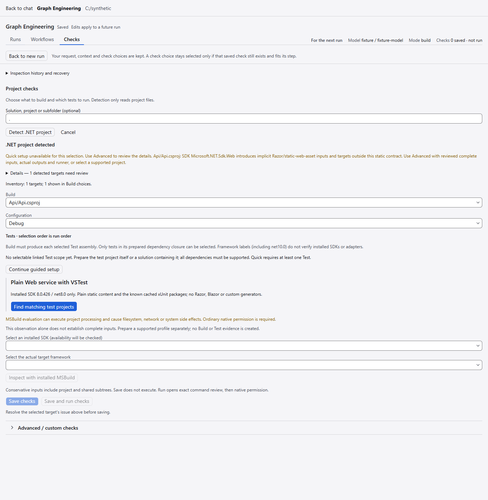         | 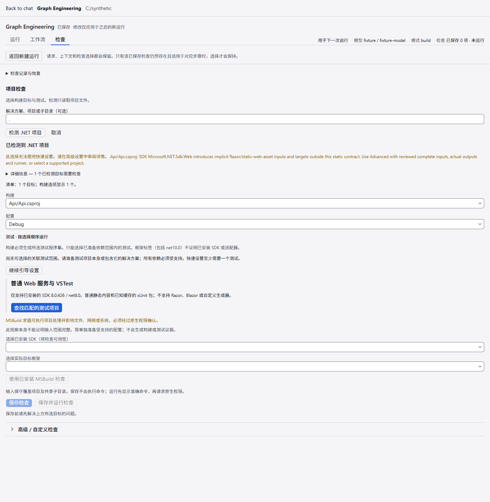         |
| Exact inspection review / 显式检查审阅             | 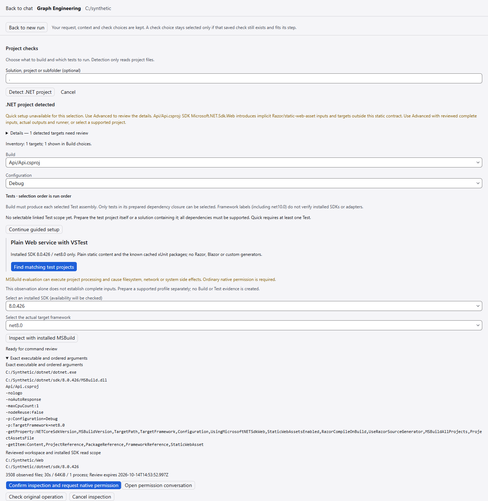     | 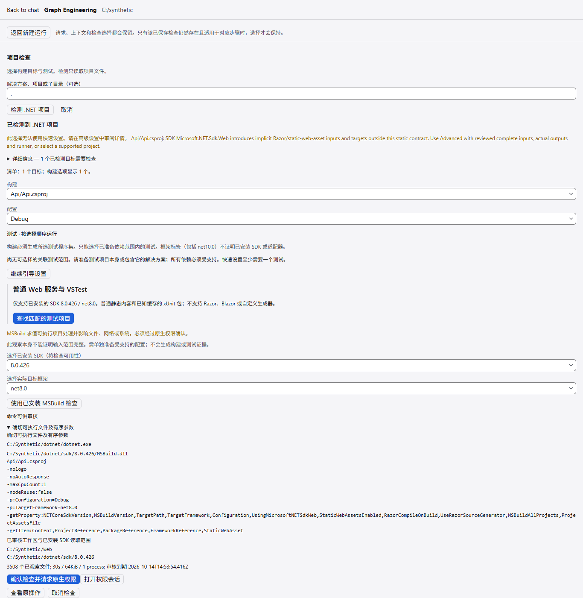     |
| Permission denied / 权限被拒绝                     | 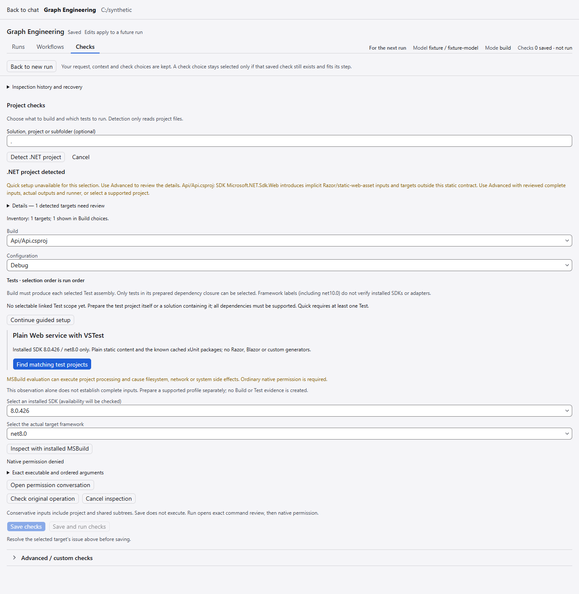     | 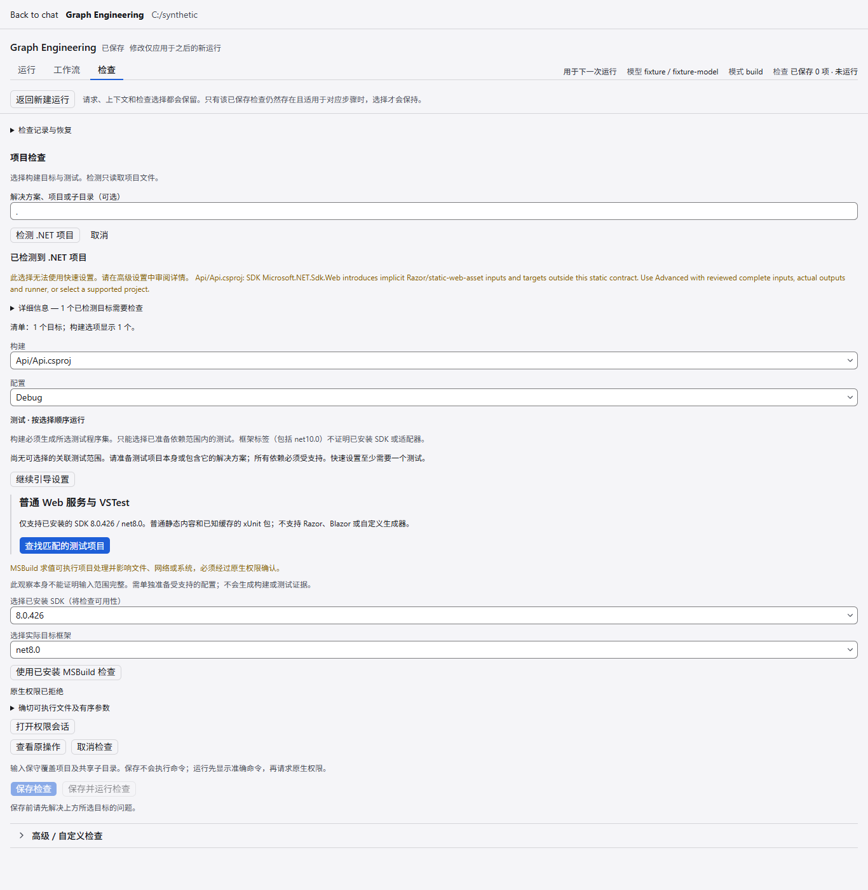     |
| Matching Test only / 排除无关测试                  | 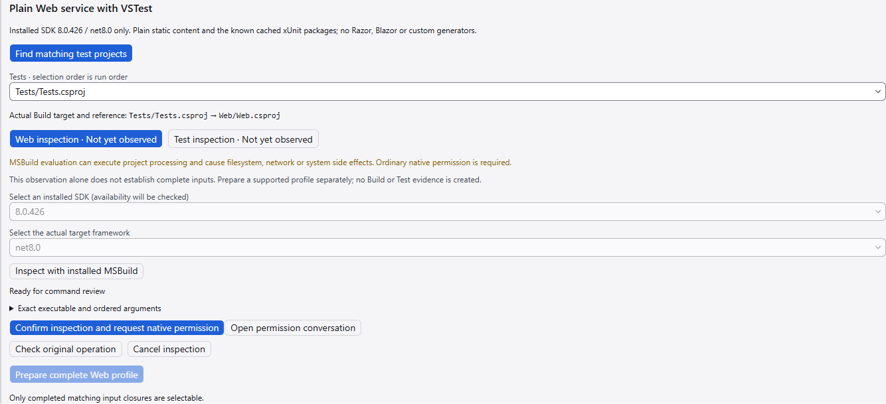             | 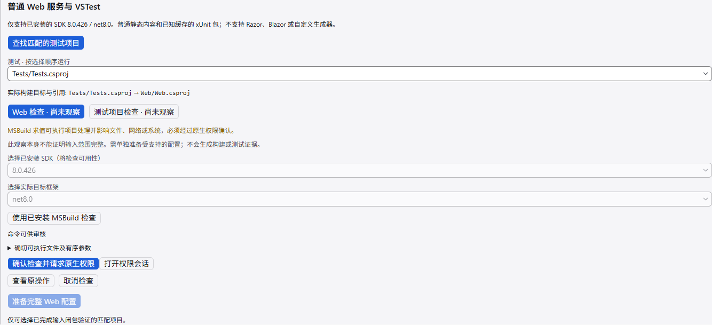             |
| Source verification / 验证源字节                   | 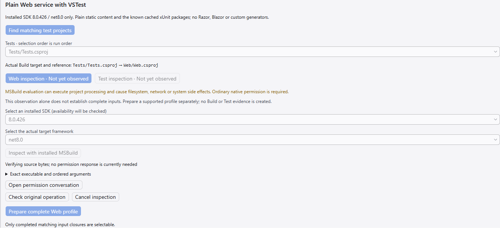 | 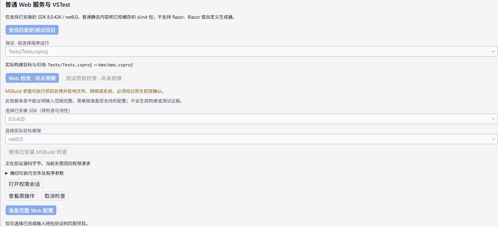 |
| Complete supported proposal / 受支持的完整配置提案 | 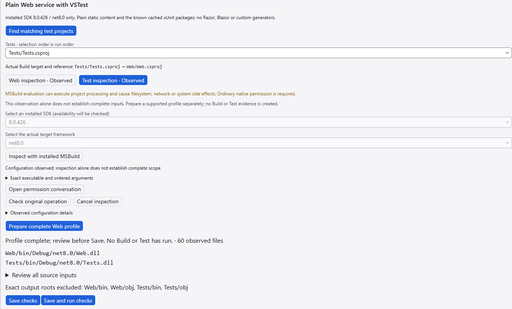   | 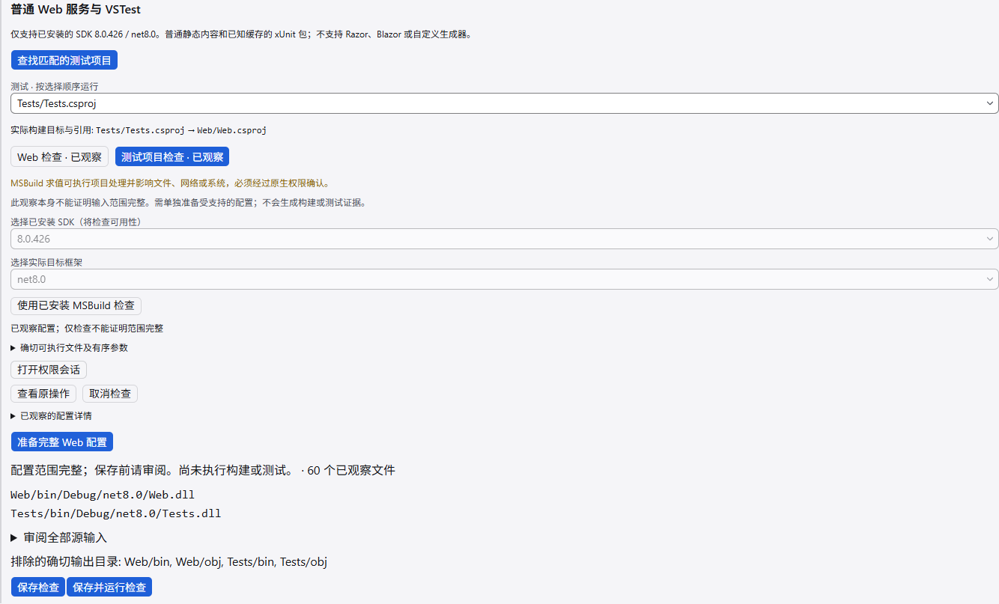   |
| Saved and reopened / 保存后重新打开                | 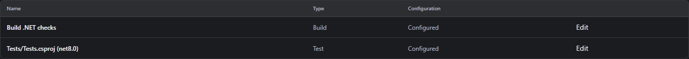           | 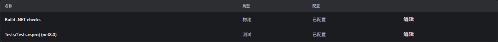           |
