# UX-P1 rendered evidence

Synthetic real-component renders (not packaged Electron, not native execution, not
company-PC validation). **Before** = the unchanged common commit `67e5702` in a separate
pristine worktree; **after** = this branch. Same harness, same synthetic records, same
viewport/locale/theme per row. Chromium 141 (Linux), DPR 1. Details: `capture-audit.json`;
all captures (42 after, 40 before; focus is after-only) with text size and overflow flags: `metrics.json`.

Text size is reported only as context. Acceptance is whether state, failure and the next
action stay truthful and findable.

## Changed states

| State                                          | Before                                                      | After                                                      | What changed / what stays                                                                                                                                                                                                                                                                                                                                  |
| ---------------------------------------------- | ----------------------------------------------------------- | ---------------------------------------------------------- | ---------------------------------------------------------------------------------------------------------------------------------------------------------------------------------------------------------------------------------------------------------------------------------------------------------------------------------------------------------- |
| Unsupported selected project (1366, en, dark)  | 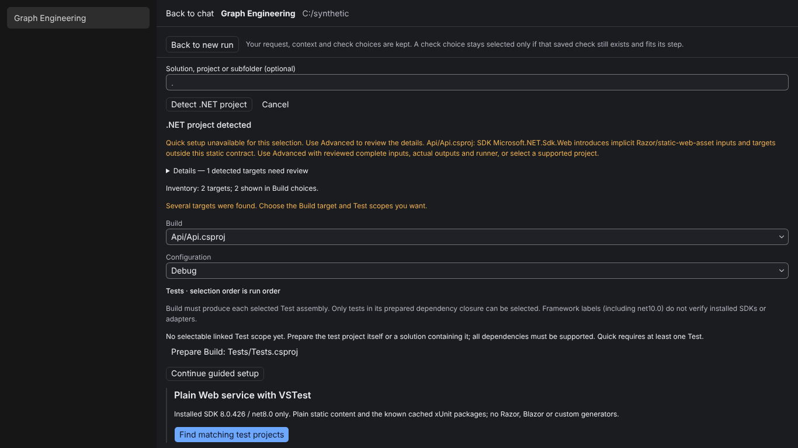                     | 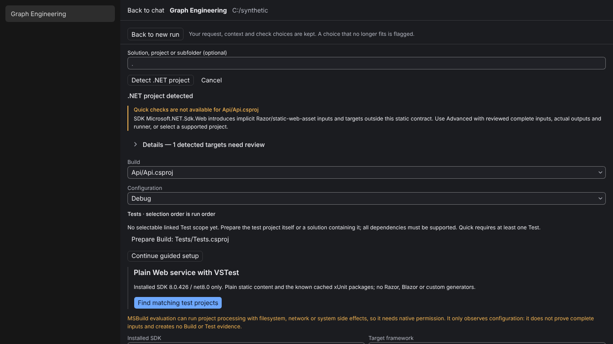                     | One blocker block names the target and keeps the exact cause and next step. The stacked "unavailable / several targets / inventory / test-link" paragraphs are gone; Details holds the inventory and general explanations. Save stays disabled with its reason. 2347 → 1796 chars.                                                                           |
| Command review before authorizing (1600, light) | 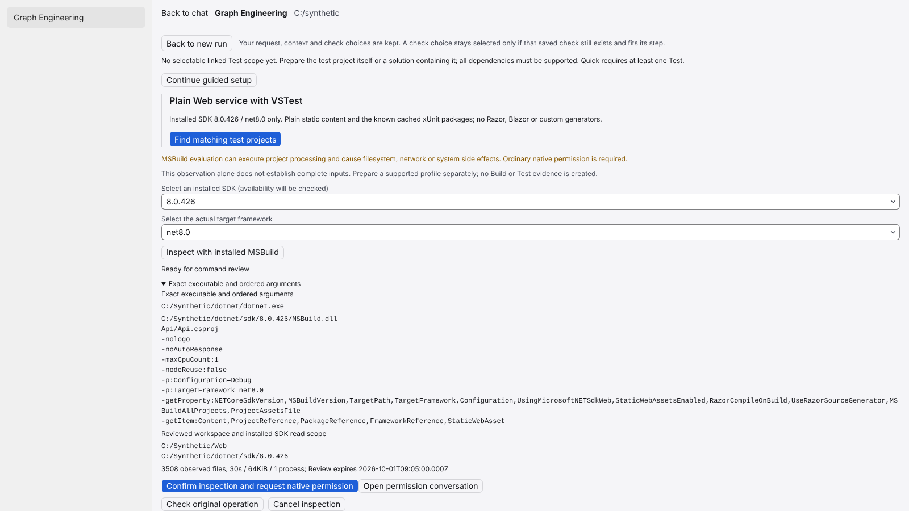                      | 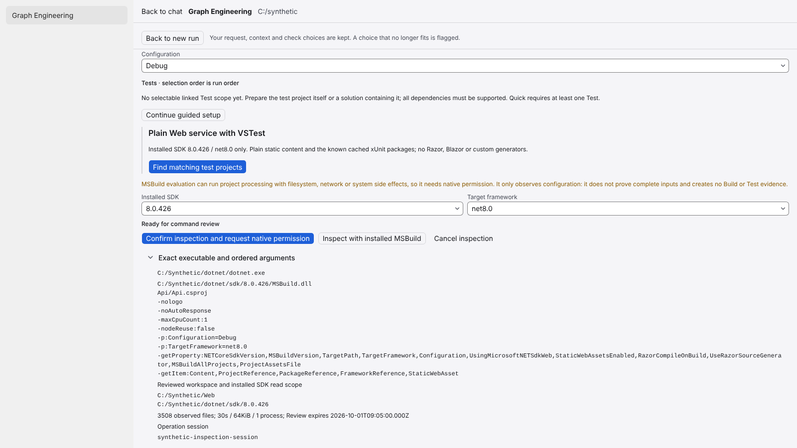                      | Exact executable, ordered arguments, read scope, file count, limits and expiry stay open. One side-effect notice replaces two paragraphs; SDK/framework sit in one row; the single primary action is Confirm; duplicate heading removed. 3151 → 2633 chars.                                                                                                  |
| Source verification (1366, en, dark)           | 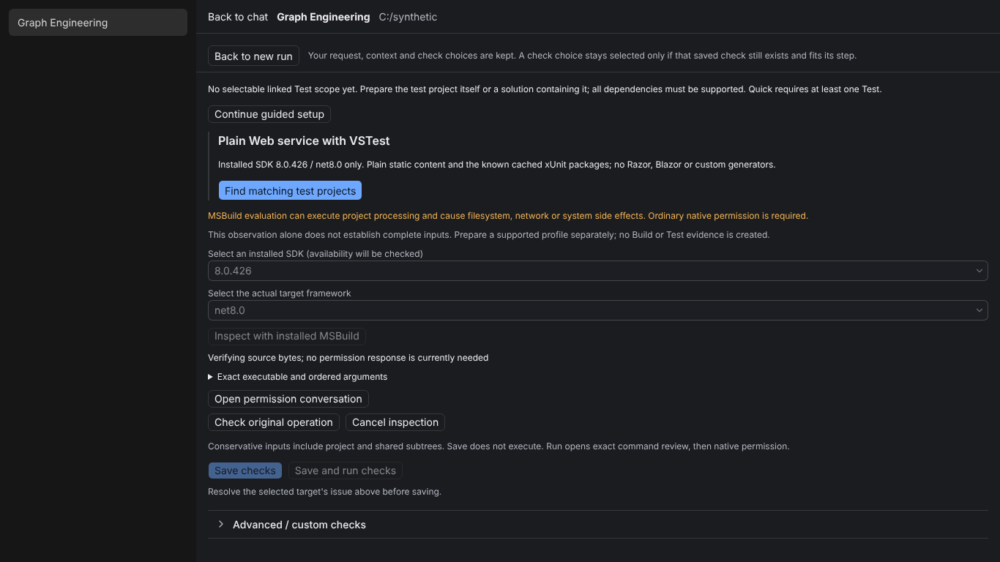                   | 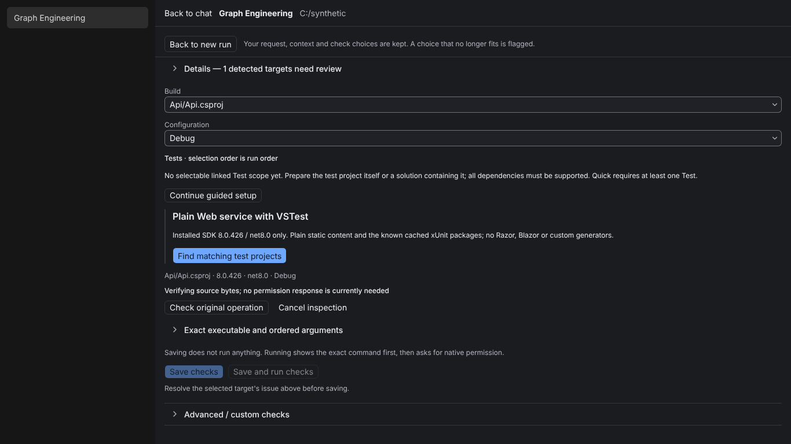                   | Before offered "Open permission conversation" although no permission exists. Now: summary line, "no permission response is currently needed", status check and cancel. Disabled selects become one line. 2428 → 1660 chars.                                                                                                                                  |
| Real permission wait (1093×614, zh, light)     | 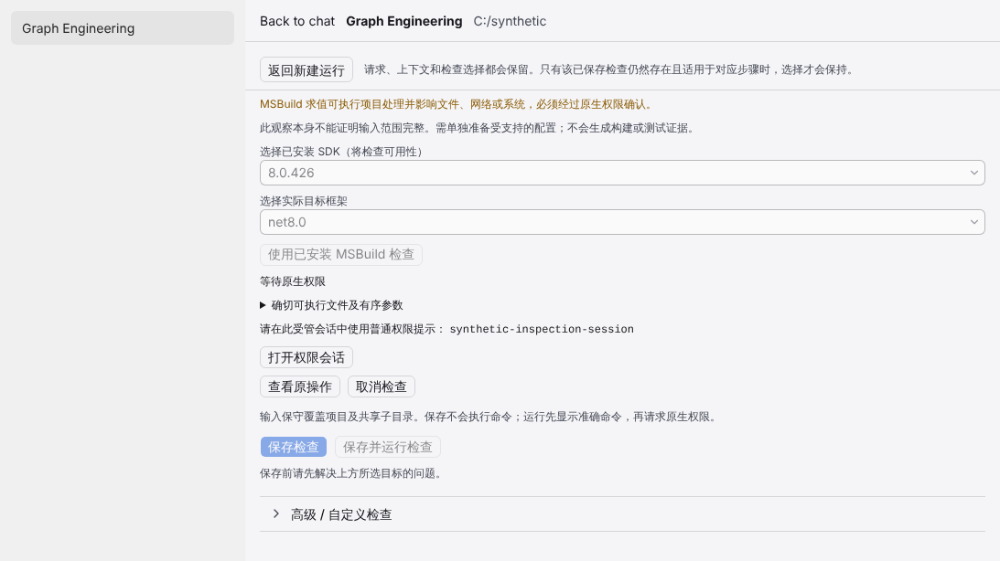               | 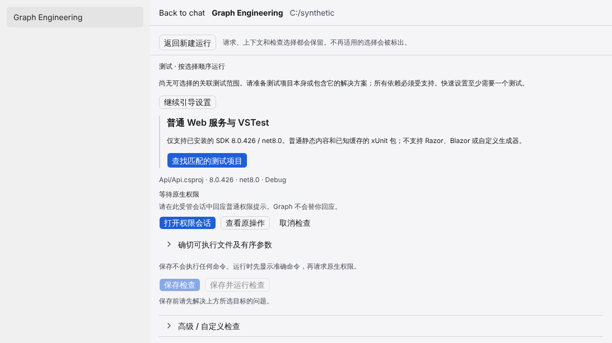               | Stage line, one instruction that Graph never answers the prompt, primary "open permission conversation", status check and cancel. The raw session id moved into the command details. 1118 → 873 chars.                                                                                                                                                     |
| Expired review (1093×614, zh, light)           | 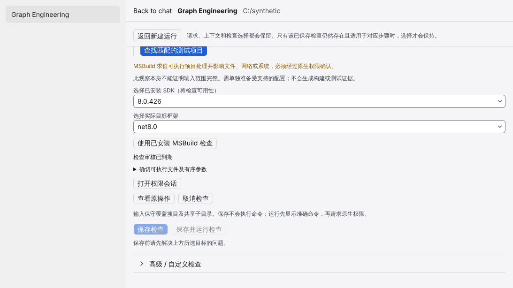                  | 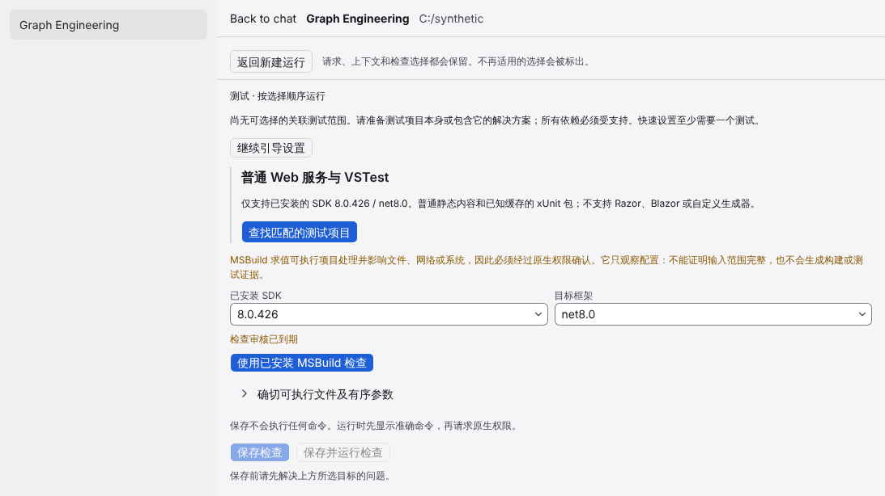                  | The expiry is a warning-toned stage line and "inspect again" is the one primary action; an expired review cannot be confirmed. 1072 → 902 chars.                                                                                                                                                                                                            |

## Unchanged states (after only)

The run view was already operator-first (U1/UX-M4) and its banner statements are asserted
contracts, so it is unchanged: visible text is identical before and after for all running,
permission, approval, failed-Test, invalid-evidence and stale-evidence captures (see
`metrics.json`, `visibleTextIdentical`).

| State                                             | After                                           |
| ------------------------------------------------- | ----------------------------------------------- |
| Assertion FAIL: "Test failed", failure inspection | 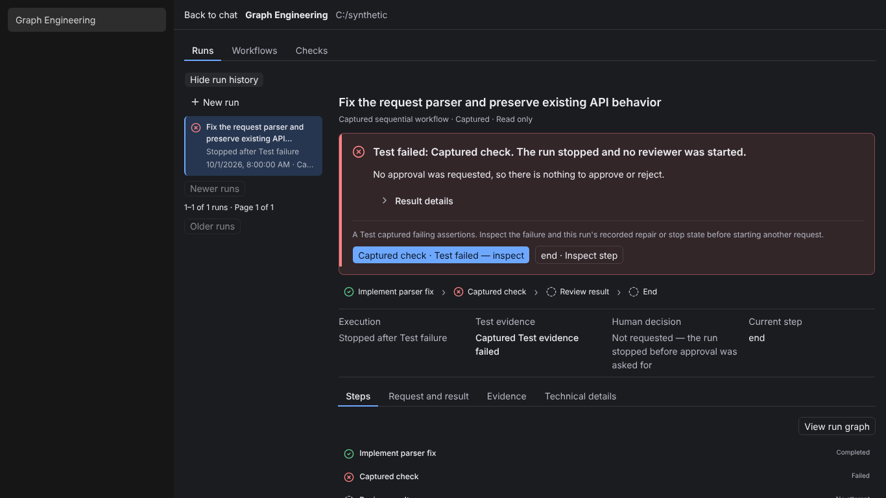             |
| Invalid evidence: a different fact and action     | 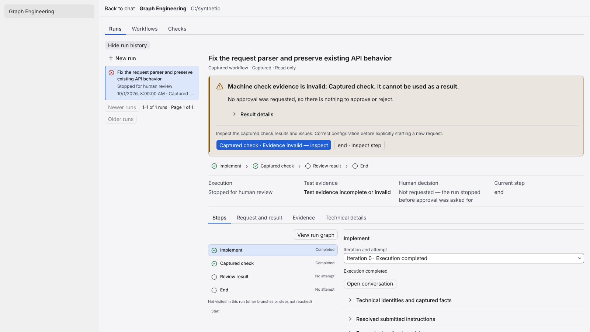        |
| Final human approval pending                      | 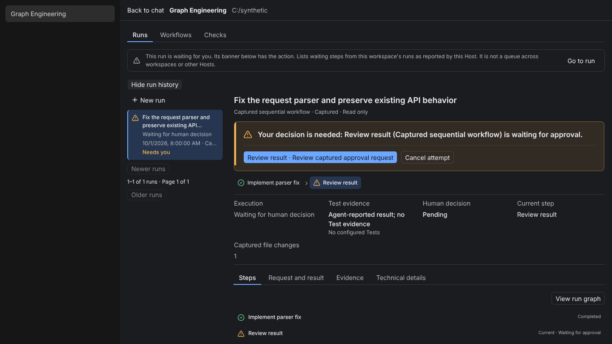                |
| Stale evidence stop (1093×614, zh, light)         | 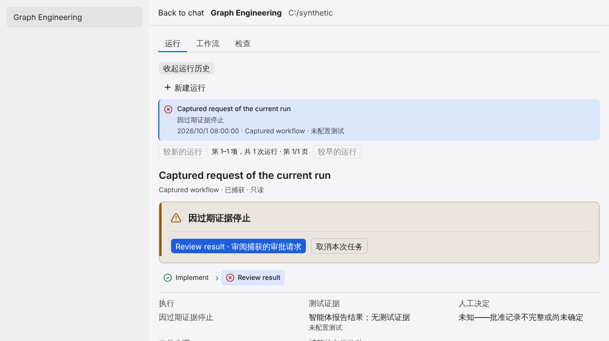         |
| Keyboard focus on the primary inspection action   | 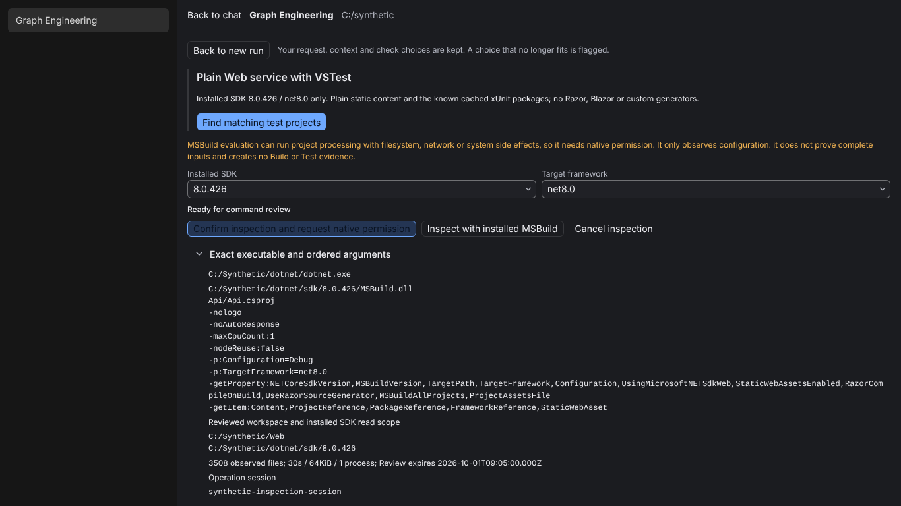            |

Observation (not changed here): the focused primary Button renders a dark fill with a
low-contrast label. That is the shared Button/global focus style, outside this lane's
allowed files.

Interaction coverage (Tab/Enter/Escape, focus return, retained draft and selected run,
disabled actions, zero extra Host calls) is asserted by `scripts/graph-engineering/ux-p1-behavior.mjs`
rather than screenshotted.
