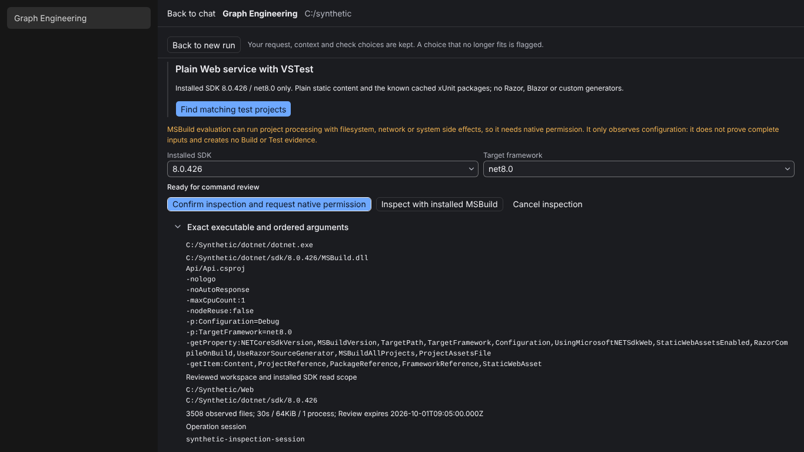
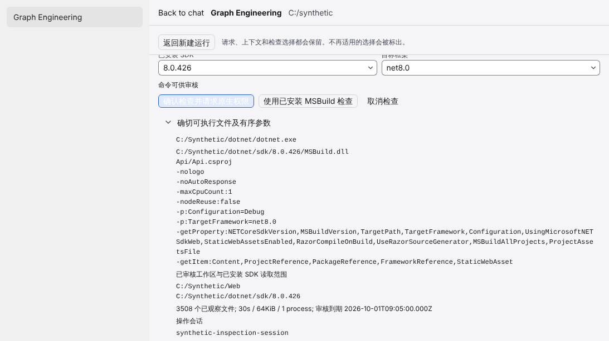
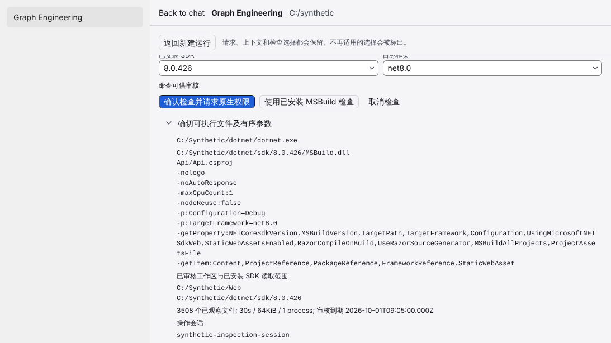
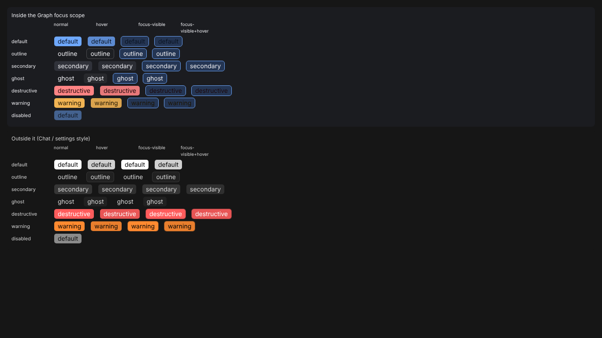
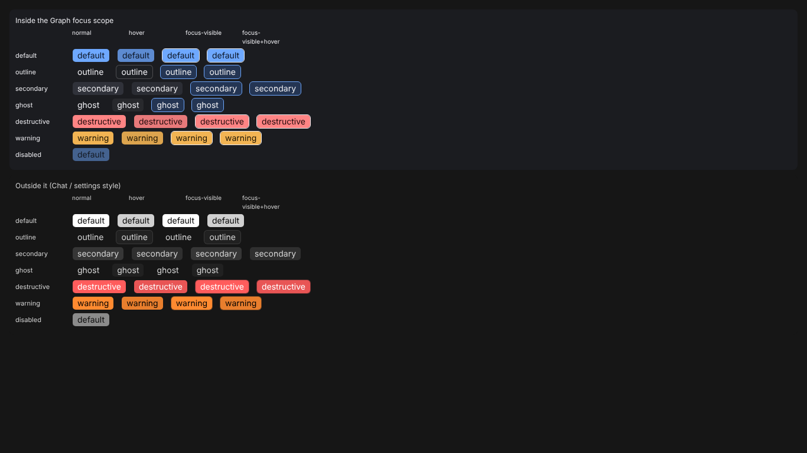

# UX-P1-F1 focused-button readability: supplemental evidence

Six images; the original 15-image UX-P1 gallery is unchanged. Synthetic real-component renders in
Cloud Chromium 141 (Linux), DPR 1, with real keyboard Tab navigation. **Before** = pristine
checkout of `2446d0c0e0a1e8189cad137fa36436b77bb0f9ea`; **after** = this branch. Not Windows,
Electron, native or whole-app accessibility acceptance.

| Case                                                  | Before                                          | After                                          | Measured label contrast (focused)                                                     |
| ----------------------------------------------------- | ----------------------------------------------- | ---------------------------------------------- | ------------------------------------------------------------------------------------- |
| Confirm primary after Tab, dark, 1366×768             |          |          | `#0a1322` on `#243553` **1.51:1** → on `#6ea8fe` **7.70:1**                            |
| Confirm primary after Tab, light, 1093×614 (Chinese)  |      |      | `#ffffff` on `#e1eafb` **1.21:1** → on `#1e5fd8` **5.70:1**                            |
| Button variant matrix, dark (forced states, see note) |                 |                 | default 1.51→7.70, destructive 1.58→8.20, warning 1.50→10.00; others unchanged         |

The matrix shows normal / hover / focus-visible / focus-visible+hover per variant inside and
outside the Graph focus scope. Because only one element can hold real focus, the matrix uses
DevTools forced `:focus-visible`/`:hover` to display every state at once; the real-Tab
measurements are the Confirm rows and the Tab/Enter/Space assertions in `ux-p1-focus.mjs`.
Light-theme matrix and the full per-state numbers are in `measurements/`.

`measurements/before|after/*.json` hold computed foreground/fill/border (sRGB, composited over the
ancestors) and the WCAG ratios for every case. Contrast = (L1+0.05)/(L2+0.05) on relative luminance.
